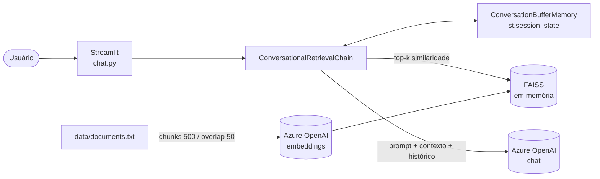
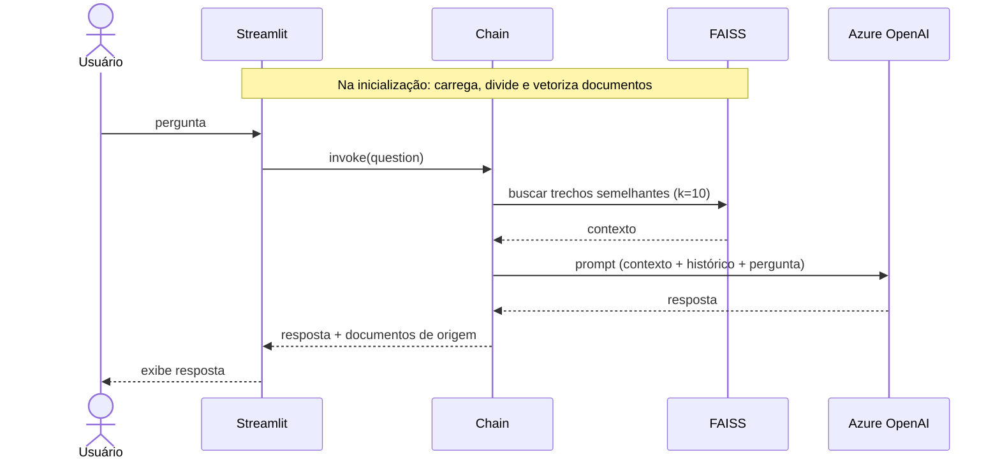

# Chatbot RAG com LangChain, FAISS e Azure OpenAI

Chatbot conversacional que responde com base em documentos locais (RAG), mantendo o histórico da conversa na sessão do Streamlit.


## 🏗️ Arquitetura

### Visão geral



### Pipeline



## 🧭 Decisões de arquitetura

| Decisão | Motivo | Trade-off |
|---|---|---|
| **RAG** em vez de fine-tuning | Conhecimento atualizável sem retreinar e com menor custo | Qualidade depende do *chunking* e da recuperação |
| **FAISS** em memória | Simples, sem serviço externo | Índice é recriado a cada inicialização; não escala nem persiste |
| Chunks de 500 caracteres, overlap 50 | Bom ponto de partida para texto corrido | Precisa de ajuste conforme o tipo de documento |
| **Azure OpenAI** | Governança, rede privada e conformidade corporativa | Exige provisionar deployments (chat e embeddings) |
| Memória na `session_state` | Contexto por usuário sem backend | Perdida ao recarregar a sessão |

## ⚠️ Limitações

- Apenas um arquivo de texto (`data/documents.txt`) é ingerido; não há upload dinâmico de documentos.
- O índice FAISS não é persistido, então cada reinício gera novos embeddings (custo e tempo).
- Não há avaliação de qualidade da recuperação nem das respostas.
- Chaves em `.streamlit/secrets.toml`; em produção, use **Azure Key Vault** com Managed Identity.

## 🚀 Roadmap para produção

- [ ] Persistir o índice (FAISS em disco) ou migrar para **Azure AI Search**
- [ ] Suporte a vários formatos (PDF, Markdown) e ingestão incremental
- [ ] Busca híbrida (vetorial + palavra-chave) e *reranking*
- [ ] Avaliação do RAG (relevância do contexto, fidelidade, correção) no CI
- [ ] Citação das fontes na interface (os documentos de origem já são retornados)
- [ ] Autenticação via Entra ID / Managed Identity e observabilidade (tokens, custo, latência)

## ▶️ Como executar

Pré-requisitos: Python 3.8+ e um recurso Azure OpenAI com deployments de chat e de embeddings.

```bash
git clone https://github.com/dgmodesto/chat-rag-azure-openai.git
cd chat-rag-azure-openai
python -m venv venv
venv\Scripts\activate            # Linux/macOS: source venv/bin/activate
pip install -r requirements.txt
```

Crie `.streamlit/secrets.toml`:

```toml
AZURE_OPENAI_API_KEY = "your_api_key"
AZURE_OPENAI_ENDPOINT = "https://your-resource-name.openai.azure.com/"
AZURE_DEPLOYMENT_NAME = "your_deployment_name"
AZURE_MODEL_NAME = "gpt-4o-mini"
AZURE_API_VERSION = "2024-08-01-preview"

AZURE_DEPLOYMENT_EMBEDDING_ENDPOINT = "https://your-resource-name.openai.azure.com/"
AZURE_DEPLOYMENT_EMBEDDING_NAME = "your_embedding_deployment"
AZURE_EMBEDDING_MODEL_NAME = "text-embedding-ada-002"
AZURE_EMBEDDING_API_VERSION = "2023-05-15"
```

```bash
streamlit run chat.py
```

## 📁 Estrutura

```
├── chat.py            # App Streamlit + chain RAG
├── data/documents.txt # Base de conhecimento
└── requirements.txt
```

## 🛠️ Stack

Python · LangChain · FAISS · Azure OpenAI · Streamlit
