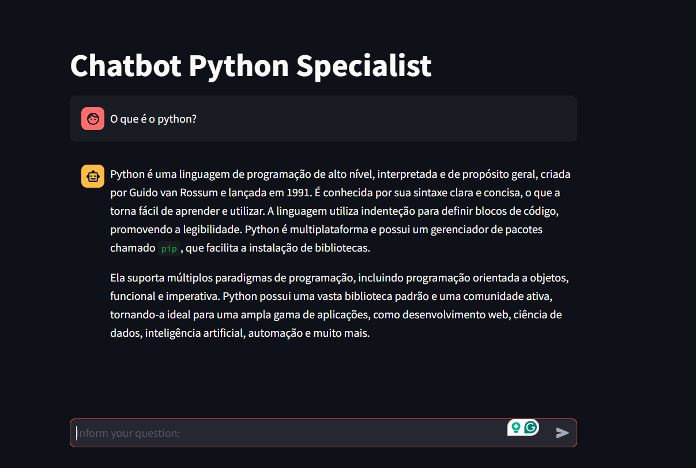
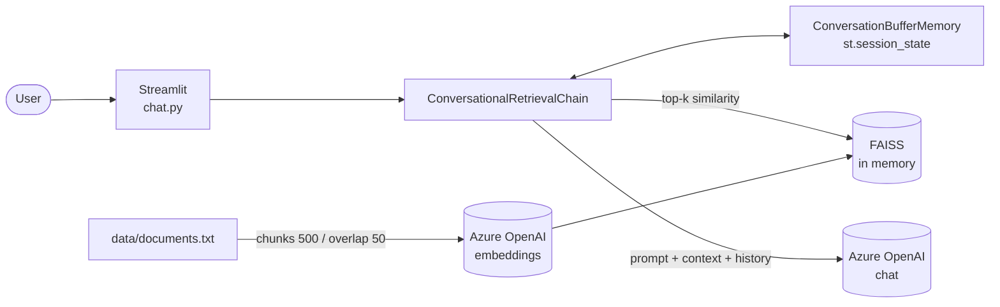
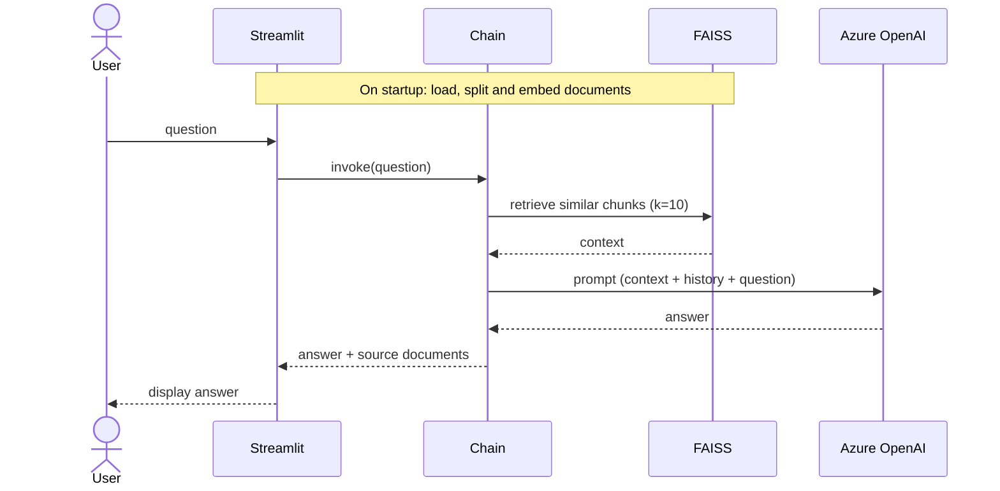

# RAG Chatbot with LangChain, FAISS and Azure OpenAI

A conversational chatbot that answers based on local documents (RAG), keeping conversation history in the Streamlit session.



## 🏗️ Architecture

### Overview



### Pipeline



## 🧭 Architecture decisions

| Decision | Rationale | Trade-off |
|---|---|---|
| **RAG** instead of fine-tuning | Knowledge can be updated without retraining, at lower cost | Quality depends on chunking and retrieval |
| In-memory **FAISS** | Simple, no external service | Index is rebuilt on every start; doesn't scale or persist |
| 500-char chunks, 50 overlap | Good starting point for running text | Needs tuning per document type |
| **Azure OpenAI** | Governance, private networking and enterprise compliance | Requires provisioning chat and embedding deployments |
| Memory in `session_state` | Per-user context without a backend | Lost when the session reloads |

## ⚠️ Limitations

- Only one text file (`data/documents.txt`) is ingested; there is no dynamic document upload.
- The FAISS index is not persisted, so each restart regenerates embeddings (cost and time).
- No evaluation of retrieval or answer quality.
- Keys live in `.streamlit/secrets.toml`; in production, use **Azure Key Vault** with Managed Identity.
- The prompt and sample knowledge base are in Portuguese.

## 🚀 Roadmap to production

- [ ] Persist the index (FAISS on disk) or migrate to **Azure AI Search**
- [ ] Support multiple formats (PDF, Markdown) and incremental ingestion
- [ ] Hybrid search (vector + keyword) and reranking
- [ ] RAG evaluation (context relevance, faithfulness, correctness) in CI
- [ ] Show source citations in the UI (source documents are already returned)
- [ ] Entra ID / Managed Identity authentication and observability (tokens, cost, latency)

## ▶️ Running locally

Prerequisites: Python 3.8+ and an Azure OpenAI resource with chat and embedding deployments.

```bash
git clone https://github.com/dgmodesto/chat-rag-azure-openai.git
cd chat-rag-azure-openai
python -m venv venv
venv\Scripts\activate            # Linux/macOS: source venv/bin/activate
pip install -r requirements.txt
```

Create `.streamlit/secrets.toml`:

```toml
AZURE_OPENAI_API_KEY = "your_api_key"
AZURE_OPENAI_ENDPOINT = "https://your-resource-name.openai.azure.com/"
AZURE_DEPLOYMENT_NAME = "your_deployment_name"
AZURE_MODEL_NAME = "gpt-4o-mini"
AZURE_API_VERSION = "2024-08-01-preview"

AZURE_DEPLOYMENT_EMBEDDING_ENDPOINT = "https://your-resource-name.openai.azure.com/"
AZURE_DEPLOYMENT_EMBEDDING_NAME = "your_embedding_deployment"
AZURE_EMBEDDING_MODEL_NAME = "text-embedding-ada-002"
AZURE_EMBEDDING_API_VERSION = "2023-05-15"
```

```bash
streamlit run chat.py
```

## 📁 Structure

```
├── chat.py            # Streamlit app + RAG chain
├── data/documents.txt # Knowledge base
└── requirements.txt
```

## 🛠️ Stack

Python · LangChain · FAISS · Azure OpenAI · Streamlit
